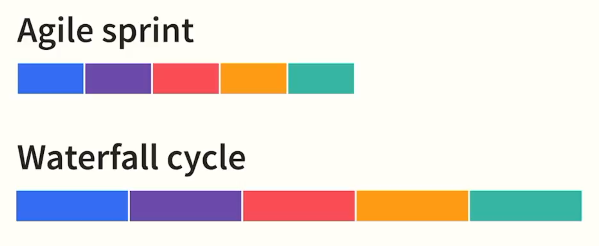

## Lecture Notes: All About a Product Manager

**Course:** Product Management: First Steps | **Topic:** What a PM is and the skills the role requires

### Summary

The product manager is the **glue** that connects every stakeholder on a product team, the **approver** of decisions that affect the product, and the person the team relies on to **lead them confidently through development**. The role spans many disciplines: research, design, technical understanding, marketing, and communication. You don’t need to master all of them on day one. They can all be learned, and what matters most at the start is a genuine desire to solve problems and build products customers love.

### Core idea

> **A PM sits at the center of the product team, connecting people, making decisions, and guiding the product from idea to market.**
> 

### The PM’s three roles

| Role | What it means | Why it matters |
| --- | --- | --- |
| **Glue** | Connects designers, engineers, marketers, leadership, and customers | Everyone stays aligned and informed |
| **Decision approver** | Gives final approval on decisions that affect the product | Prevents delays and conflicting directions |
| **Confident leader** | Guides the team through the development process | The team trusts the PM when things get uncertain |

*Note: “approver” does not mean “boss.” A PM usually leads through influence and clarity rather than authority.*

### The disciplines of a PM

The lecture walks through the product journey. Here it is as a flow:

**Discover → Design → Build → Launch → Communicate**

| Stage | What the PM does | Skill involved |
| --- | --- | --- |
| **1. Discover: decide what to create** | Research current customers and prospects to understand their challenges and needs | User and market research |
| **2. Design: visualize the product** | Work with designers to decide how the product looks, feels, and how people interact with it | Prototyping, visualization |
| **3. Build: plan the structure** | Understand how the functional parts work together and plan the major sections | Product architecture |
| **3b. Technical fluency** | Communicate with developers, understand their challenges, suggest alternatives, reduce schedule risk | Programming experience (valuable, especially in tech) |
| **4. Launch: take it to market** | Position the product and partner with marketing | Personas, campaign design, content design |
| **5. Communicate: pitch and align** | Get buy-in from stakeholders, explain what and why | Writing, visuals, presentation decks |
| **6. Engage: meet the world** | Speak with customers, meet vendors, attend events, present | Public speaking, relationship building |

### Each discipline explained

#### 1. Research

Before building anything, understand who your customers and prospects are and what problems they face. Prospects matter too, because they show you who you could win in the future.

#### 2. Visualization and prototyping

A prototype is a rough, early version of the product used to test how it will look and feel. It lets you work with designers and get feedback before engineers spend months building.

#### 3. Architecture and planning

Knowing how the functional parts fit together lets you break the product into major sections and plan the work in a logical order.

#### 4. Programming experience

You don’t need to be an engineer, but some coding knowledge helps you:

- Understand the challenges developers describe
- Offer alternative solutions that make their work easier
- Spot and reduce **scheduling issues** early

#### 5. Positioning and go-to-market

- **Personas:** fictional but research-based profiles of typical users (e.g., “Priya, 28, busy marketing professional”).
- **Campaign design and content design:** shaping the messages and materials that introduce the product.

You partner with marketing; you don’t do their job, but you must speak their language.

#### 6. Having a specific launch goal

Every launch should aim at one of three things:

| Goal | Meaning |
| --- | --- |
| **Solve an existing business issue** | Fix a current problem (e.g., high customer churn) |
| **Expand current opportunities** | Grow within your existing market |
| **Establish a new market** | Enter an area the company hasn’t served before |

#### 7. Communication and vision pitching

Getting stakeholder buy-in requires you to write, create copy and visuals, and build presentation decks that clearly explain **what** you are building and **why**.

#### 8. Getting out in the field

Meeting customers and vendors, attending events, and giving presentations **humanizes the product** and gives you **firsthand insight** into what customers want, which no dashboard can fully replace.

### Example *(not from the lecture)*

**A PM at a food delivery app building a “group ordering” feature**

| Stage | What the PM does |
| --- | --- |
| Research | Interviews office workers who struggle to order lunch together |
| Prototype | Works with a designer on a clickable mockup of a shared cart |
| Architecture | Maps how cart, payment split, and restaurant systems connect |
| Technical fluency | Learns from engineers that real-time cart syncing is expensive and suggests a simpler “host pays, others add items” version to hit the date |
| Positioning | Defines the persona “office team lead” and works with marketing on a campaign |
| Launch goal | Expand existing opportunity: more orders per customer |
| Pitching | Presents a deck to leadership showing user pain and projected impact |
| In the field | Visits partner restaurants and a few offices to watch it being used |

### The PM skill map

| Skill group | Includes |
| --- | --- |
| **Customer and market** | Research, personas, positioning |
| **Design and product** | Prototyping, visualization, architecture |
| **Technical** | Programming familiarity, working with developers |
| **Business and go-to-market** | Launch goals, campaign and content design |
| **Communication** | Writing, presentations, public speaking, stakeholder management |

### Why this matters for you

- **You don’t need to be an expert in all of these.** The lecture says directly that they can all be learned.
- **Start with your gaps.** A designer moving into PM may need technical depth; an engineer may need communication and marketing skills.
- **The role is broad by design.** This breadth is why PMs can feel like “mini CEOs” of a product, though they usually have responsibility without direct authority.
- **Interview relevance.** “What skills does a PM need?” and “Why do you want to be a PM?” are common questions, and this lecture gives you a ready framework.

### Key takeaways

1. The PM is the **glue**, the **decision approver**, and the **confident leader** of the team.
2. The role spans research, design, architecture, technical fluency, marketing, and communication.
3. Programming experience is especially valuable in tech because it improves collaboration with developers.
4. Every launch needs a **specific goal**: solve a current problem, expand current opportunities, or open a new market.
5. Pitching and stakeholder buy-in depend on clear communication in writing, visuals, and presentations.
6. Getting out to meet customers and vendors humanizes the product.
7. The core requirement to begin: a **desire to solve problems** and build products customers love.

### Common mistakes and misconceptions

- ❌ “A PM must be an expert in everything.” You need working knowledge across areas, not mastery of each.
- ❌ “A PM must be a programmer.” Programming experience helps, but it isn’t mandatory.
- ❌ “Approver of decisions means PM makes every decision alone.” The PM approves decisions after input from designers, engineers, and others.
- ❌ “PMs sit in an office and write documents.” Fieldwork, customer meetings, and events are a significant part of the job.
- ❌ “Marketing starts after the product is built.” The PM should think about personas and positioning during development.

### Self-test questions

1. Why is the PM described as “the glue” of the team?
2. List the three possible goals when bringing a product to market. Which one fits a company launching in a new country?
3. How can programming experience help a PM reduce scheduling problems?
4. Why is it valuable for a PM to meet customers in person instead of relying only on data?
5. Which two skills in the skill map are you strongest in, and which two do you most need to develop?

### Quick recap of the course so far

| Lecture | One-line takeaway |
| --- | --- |
| 1. Types of products | Six types: user, component, platform, service, standard, process |
| 2. Product vs. project | Product = right thing; project = feasible delivery |
| 3. Industry impact | Industry shapes regulation, change cost, and pivot ease |
| 4. All about a PM | The PM is the glue, decision approver, and leader across many disciplines |

---

## Lecture Notes: Leading Through Influence as a Product Manager

**Course:** Product Management: First Steps | **Topic:** Why a PM leads without authority, and how

### Summary

Despite the word “manager” in the title, a product manager is **not the boss** of the team. Engineers, designers, marketers, and researchers do not report to the PM. The PM must **lead through influence**: acting as a partner, staying emotionally aware of the team, making sure everyone understands the product’s purpose, and always listening. The lecture’s argument is that not being their boss is actually an **advantage**, because it pushes you toward trust-based leadership rather than orders.

### Core idea

> **A PM is a leader, not a manager. You earn alignment through clarity, trust, and listening, not through authority.**
> 

### Leadership vs. management

| Aspect | Management (boss) | Leadership through influence (PM) |
| --- | --- | --- |
| **Reporting line** | People report to you | No one reports to you |
| **How work gets done** | Assign tasks, give orders | Persuade, align, collaborate |
| **Relationship** | Hierarchical | Partnership; “same journey” |
| **Source of authority** | Position or title | Credibility, clarity, trust |
| **Focus** | Output and progress | Output **plus** morale, confidence, and shared understanding |

### The three things a PM leader keeps watch on

The lecture gives three situations. Each follows the same pattern: **notice a problem, then take a concrete action.**

| # | Signal to watch for | Question to ask yourself | Action from the lecture |
| --- | --- | --- | --- |
| 1 | **Team wellbeing** | Are they happy, motivated, tired, or burnt out? | Defer some work to a later phase or sprint so the team feels less rushed and more confident |
| 2 | **Lack of clarity** | Does the team understand what the product is for and how it helps customers? | Hold a **brown bag** with customers so the team hears the purpose firsthand |
| 3 | **Unheard ideas** | Does the team feel I’m not listening to their solutions? | Keep a standing way to receive suggestions, and always be open to listen |

#### 1. Emotional awareness

Monitoring progress is not enough. If you are pushing too hard, quality and morale both suffer. The PM should always be able to answer “How is my team feeling?” and then adjust the plan accordingly.

**Key term: Sprint.** A short, fixed period of development work (commonly 1 to 4 weeks). Moving work to a later sprint reduces pressure on the current one.

#### 2. Creating shared clarity

You have spoken to customers, so you understand the “why.” The team may not. If they don’t share your clarity, they cannot make good small decisions on their own.

**Key term: Brown bag.** An informal session, often held over lunch, where people bring their own food and listen to a talk or discussion. Here, customers share their stories with the team directly.

#### 3. Listening to the experts

Engineers, designers, and others are experts in their craft. A brilliant solution may come from them, but only if they feel safe sharing it. If they sense you aren’t listening, they stop offering ideas, and you lose your best source of improvement.

### Examples *(not from the lecture)*

**Wellbeing:** Your team has shipped three tight releases in a row and you notice quieter standups and more missed deadlines. You move a lower-priority feature out of the next sprint and tell the team why. Result: they regain breathing room and trust you more.

**Clarity:** Engineers building a “scheduled orders” feature keep debating edge cases because they don’t know who it’s for. You invite two office workers to a 30-minute brown bag. The team hears “I can’t order lunch at 1 pm because I’m in back-to-back meetings” and the design decisions become obvious.

**Listening:** A backend engineer suggests caching restaurant menus to speed up load times, something you hadn’t considered. You adopt it, credit the engineer publicly, and add a regular “ideas” slot in sprint planning so more suggestions surface.

### How to lead through influence (practical toolkit)

*Some of these go beyond the lecture but follow directly from its principles.*

- **Explain the why, not just the what.** People follow reasons more willingly than instructions.
- **Listen first, decide second.** Ask for input before announcing decisions.
- **Give credit publicly, take responsibility privately.**
- **Back opinions with evidence.** Customer quotes and data persuade where authority can’t.
- **Be consistent.** Trust builds when your behavior is predictable.
- **Protect the team from noise.** Absorb stakeholder pressure instead of passing it all down.

### Why this matters for a PM

- **You can’t force anything.** If the team doesn’t believe in the direction, they won’t commit, and you have no authority to compel them.
- **Morale affects delivery.** Burnt-out teams produce slower, buggier work, so caring about wellbeing is also good for the product.
- **Listening improves the product.** The people closest to the code and design often see solutions you can’t.
- **Interview relevance.** “How do you lead without authority?” is one of the most common PM interview questions. Answer with a story following this pattern: situation, how you built trust, how you used evidence, outcome.

### Key takeaways

1. The PM title says “manager,” but the PM is a **leader without direct authority**.
2. Nobody on the product team reports to the PM; they are **partners on the same journey**.
3. Leading well means paying attention to **emotions and morale**, not just progress.
4. Shared **clarity about the product’s purpose** helps the team do better work.
5. Always keep a **channel open for the team’s ideas**, because they are the experts.
6. Not being the boss is an **advantage**, because it pushes you to build real trust.

### Common mistakes and misconceptions

- ❌ “PM means I manage the team.” You influence them; you don’t manage them.
- ❌ “Leading through influence means being soft or never saying no.” You still make and approve decisions, but you explain them and invite input first.
- ❌ “Team morale is the engineering manager’s job, not mine.” Everyone shares it, and the PM’s decisions directly affect workload and pressure.
- ❌ “If I know the vision, the team does too.” Knowledge doesn’t transfer automatically; share it deliberately.
- ❌ “Listening means doing everything the team suggests.” It means taking ideas seriously and explaining your reasoning either way.

### Self-test questions

1. Why is the PM described as a leader rather than a manager?
2. Name the three signals a PM should watch for in the team, and one action for each.
3. What is a brown bag, and how can it help a team that lacks clarity?
4. Why might not being the team’s boss be an *advantage*?
5. Describe a time you persuaded someone without having authority over them. What worked?

### Quick recap of the course so far

| Lecture | One-line takeaway |
| --- | --- |
| 1. Types of products | Six types: user, component, platform, service, standard, process |
| 2. Product vs. project | Product = right thing; project = feasible delivery |
| 3. Industry impact | Industry shapes regulation, change cost, and pivot ease |
| 4. All about a PM | The PM is the glue, decision approver, and leader across many disciplines |
| 5. Leading through influence | Lead with trust, clarity, and listening, not authority |

---

## Lecture Notes: Your Core Product Management Team

**Course:** Product Management: First Steps | **Topic:** The people who work with you on your product every day

### Summary

A PM never works alone. They bring a product to market by working with many teams, some dedicated to one product and some shared across several. The **core team** is the group working on your product **exclusively**, from design through launch. It has three parts: **User Experience (UX)**, **Engineering (including QA)**, and **Marketing**. Other stakeholders (covered in later lectures) **complement and extend** what the core team does.

### Core idea

> **The core team is the foundation: the people who stay with the PM all the way through designing and building the product.**
> 

### The core team at a glance

| Team | Who is in it | What they own | The question they answer |
| --- | --- | --- | --- |
| **User Experience (UX)** | Designers, architects | How the product looks and how users interact with it | “How should this look and work for the user?” |
| **Engineering** | Software, network, security, service, hardware, electrical engineers | Building the features and components | “How do we build this?” |
| **Quality Assurance (QA)** | QA engineers (the “other side” of engineering) | Testing that the product works as specified | “Does it work as intended, without defects?” |
| **Marketing** | Marketers, marketing researchers | Awareness, value messaging, and how customers acquire the product | “How do customers find it, understand it, and want it?” |

### Each team explained

#### 1. User Experience (UX)

Designers and architects define **how the product looks** and **how a customer manipulates and uses it**. Their work may include:

- **Mapping the steps** needed to complete an action (a user flow)
- **Deciding what is critical vs. optional** for the user
- **Exploring variations** of a single design before choosing one

*Example:* For a food delivery app’s checkout, UX maps the flow from cart to payment, decides that address and payment are critical while “add a tip” is optional, and tests three layouts for the order summary.

#### 2. Engineering

Engineers **build** the product. The mix depends on what you make:

| Product | Likely engineers |
| --- | --- |
| Mobile app | Software, security, service (backend) |
| Smart home device | Hardware, electrical, software, network |
| Cloud service | Software, network, security, service |

They work together to create the features or components that need to be built.

#### 3. Quality Assurance (QA)

QA is described as the **other side of the engineering team**. They verify that:

1. The product is **free of defects**
2. It **meets all product specification requirements**
3. **Users can find and use features as designed**

Note the third point: QA checks not just whether the code works, but whether the feature is *discoverable and usable*.

*Example:* QA finds that the “Apply coupon” button works, but is hidden below the fold on small phones, so users would never find it. That is a usability defect, not a code bug.

#### 4. Marketing

Marketing makes sure potential customers know:

- **What** the product does
- **How it is valuable** to them
- **How to acquire it**

**Marketing researchers** help you understand “what makes your customers tick” and how to **position** the product so customers want it.

### How they work together *(not from the lecture)*

| Phase | UX | Engineering | QA | Marketing |
| --- | --- | --- | --- | --- |
| **Discover** | Research, flows | Feasibility input | Early input on testability | Customer insight |
| **Design** | Prototypes | Technical approach | Test planning | Positioning |
| **Build** | Refine designs | Build features | Test continuously | Prepare campaign |
| **Launch** | Monitor usage | Fix issues | Final verification | Run campaign |

The PM sits in the middle, keeping all four aligned (the “glue” from the earlier lecture).

### Core team vs. shared team

|  | Core team | Shared / extended team |
| --- | --- | --- |
| **Dedicated to your product?** | Yes, exclusively | Often shared across multiple products |
| **Involvement** | Entire lifecycle | Specific moments or needs |
| **Role** | The foundation | Complement and extend the core |

### Why this matters for a PM

- **Know each person’s expertise.** You lead through influence, so understanding what each role needs makes you more credible.
- **Bring QA in early.** Many PMs wrongly treat QA as a final step; testers who understand requirements early catch problems cheaper.
- **Involve marketing early too.** Positioning insights can shape the product, not just the launch.
- **Your team composition varies.** A hardware product needs electrical engineers; a pure app does not.
- **Interview relevance.** You may be asked: “Who do you work with day to day, and how do you work with each of them?”

### Key takeaways

1. The **core team** works exclusively on your product and stays with it from start to finish.
2. It has three groups: **UX**, **engineering (including QA)**, and **marketing**.
3. UX defines **look and interaction**; engineering **builds**; QA **verifies**; marketing **positions and promotes**.
4. Engineer types vary by product (software, network, security, service, hardware, electrical).
5. QA checks defects, specification compliance, **and** that users can find and use features as designed.
6. Other stakeholders **complement and extend** the core team’s work.

### Common mistakes and misconceptions

- ❌ “Marketing joins after the product is built.” They are part of the core team and should be involved throughout.
- ❌ “QA only finds bugs.” They also confirm specifications are met and features are usable.
- ❌ “Engineers are all software developers.” The type depends on the product.
- ❌ “UX is just making things look nice.” It includes mapping steps, prioritizing critical vs. optional, and testing variations.
- ❌ “The core team reports to the PM.” As the previous lecture said, you lead through influence.

### Self-test questions

1. What defines the “core team” versus other stakeholders?
2. List the three main groups in the core team and one responsibility of each.
3. How is QA’s job broader than “finding bugs”?
4. Which types of engineers would you need for a smart doorbell with a camera and mobile app?
5. Why might involving marketing researchers early change what you build, not just how you launch it?

### Quick recap of the course so far

| Lecture | One-line takeaway |
| --- | --- |
| 1. Types of products | Six types: user, component, platform, service, standard, process |
| 2. Product vs. project | Product = right thing; project = feasible delivery |
| 3. Industry impact | Industry shapes regulation, change cost, and pivot ease |
| 4. All about a PM | The PM is the glue, decision approver, and leader across many disciplines |
| 5. Leading through influence | Lead with trust, clarity, and listening, not authority |
| 6. Core team | UX, engineering (with QA), and marketing work with you exclusively |

---

## Lecture Notes: Your Extended Product Management Team

**Course:** Product Management: First Steps | **Topic:** The stakeholder teams that support your product beyond the core team

### Summary

Beyond the core team (UX, engineering, QA, marketing), a PM works with a wider group of **stakeholder teams**. These are often **shared resources** who contribute to several projects at once. They bring specialist knowledge in research, money, media, law, market sizing, partnerships, and funding. The final and most important group is the **users**, without whom there would be no product.

### Core idea

> **The core team builds the product. The extended team makes sure it is funded, legal, well-sized, well-publicized, and backed by the company. Users decide whether it succeeds at all.**
> 

### The extended team at a glance

| Team | What they do for your product | Question they help answer |
| --- | --- | --- |
| **Research (central)** | Large-scale surveys and studies | “What should we build, and how do we position it?” |
| **Finance** | Budgets, pricing, accounting, tax, and audit compliance | “Can we afford it, how should we price it, and are we following the rules?” |
| **Public Relations (PR)** | Connects reporters and media outlets with you to cover the product | “How do we get the press to write about it?” |
| **Legal** | Checks for material risks; protects and clears the product | “Are we protected and compliant?” |
| **Business Operations** | Measures audience size, potential, and demographics (TAM) | “How big is the opportunity, and who is it for?” |
| **Business Development** | Partnerships, vendors, and acquisitions | “Who can we team up with, hire, or buy?” |
| **Executives / Investors** | Approve strategy fit and provide resources | “Is this worth backing?” |
| **Users** | Use (and pay for) the product | “Does it solve my problem?” |

### Each team explained

#### 1. Research group

Some companies have a **centralized research group** that runs large-scale surveys and studies. Results are shared with your core team to guide **what to build** and **how to position it**. This is broader than the research a PM does personally with a few customers.

#### 2. Finance

- Helps set **budgets**
- Assists with **pricing**
- Ensures you follow **accounting, tax, and audit** rules and regulations

#### 3. Public Relations (PR)

Works **in partnership with marketing** to connect **reporters and online or mass media outlets** with you so they write about your product.

*Marketing vs. PR:* Marketing promotes your product through channels you control or pay for (ads, campaigns). PR earns coverage from third parties such as journalists.

#### 4. Legal

Partners with you to make sure there are **no material risks**. This includes:

- **Protecting** the product with **trademarks, copyrights, and patents**
- Making sure it meets legal requirements for **fair use, intellectual property, and security regulations**

| Protection | Protects |
| --- | --- |
| **Trademark** | Names, logos, brand identity |
| **Copyright** | Original creative work (code, text, design) |
| **Patent** | Inventions and unique technical methods |

#### 5. Business Operations and TAM

Business operations looks at **audience size, potential, and demographics**.

> **Total Addressable Market (TAM):** The total revenue opportunity, **measured in dollars**, if **the entire possible population** that could use your product did so.
> 

**Lecture example:** A smartphone chat app might have a TAM of **$10 billion**. Adding a **desktop version** could raise it to, say, **$20 billion**, because more people can use it.

*(Note: the transcript says “measured in dollars and based on the entire possible population.” The $ figures are illustrative.)*

**A simple way to think about TAM** *(not from the lecture)*:

`TAM = number of potential users × average revenue per user per year`

Example: 50 million potential users × ₹1,200 per year = ₹60 billion TAM.

#### 6. Business Development

Looks outward for opportunities:

- **Partnerships:** companies that can use your product in unique ways
- **Vendors:** outside providers you can hire for work or services
- **Acquisitions:** companies that could be bought and added directly to your team

#### 7. Executives and investors

They need confidence that your product will:

1. **Benefit the company**
2. **Align with company strategy**
3. Have a **reasonable chance of success** with **acceptable risk**

You must **pitch** to them to keep getting resources.

| Situation | Who you pitch to |
| --- | --- |
| Working at a company | **Executives**, using company resources |
| Independent / startup | **Investors or venture capitalists**, who fund a team and launch |

#### 8. Users

Described as **arguably the most important group**: without users, there is no product.

### Example *(not from the lecture)*

**Launching a “scheduled orders” feature in a food delivery app**

| Team | Involvement |
| --- | --- |
| Research | Shares a city-wide survey on meal-planning habits |
| Finance | Approves budget; advises on pricing a premium “scheduled delivery” fee and GST treatment |
| PR | Pitches the launch story to business and tech journalists |
| Legal | Reviews terms for refund rules and consumer protection; checks the feature name for trademark conflicts |
| Business Ops | Estimates how many urban office workers could use it (TAM) |
| Business Dev | Explores a partnership with a corporate cafeteria provider |
| Executives | Approve funding after a pitch showing strategic fit |
| Users | Test it, use it, and decide whether it stays |

### Core team vs. extended team

|  | Core team | Extended team |
| --- | --- | --- |
| **Dedication** | Exclusive to your product | Often shared across products |
| **Involvement** | Entire lifecycle | Specific needs and moments |
| **Examples** | UX, engineering, QA, marketing | Research, finance, PR, legal, biz ops, biz dev, executives, users |
| **PM approach** | Daily collaboration | Plan ahead; book time early |

### Why this matters for a PM

- **Plan around shared resources.** Legal or finance may be serving ten products. Engage them early rather than at the last minute.
- **Legal and finance can block a launch.** A missed trademark check or tax rule can delay everything.
- **TAM shapes your pitch.** Executives and investors want to see the size of the opportunity.
- **Expanding platforms expands TAM.** The lecture’s chat app example shows how adding a platform can double the market.
- **Pitching is a continuing job.** Resources must be earned and re-earned.
- **Interview relevance.** Be ready for “How do you work with legal, finance, and other stakeholders?”

### Key takeaways

1. The **extended team** is made up of **shared stakeholder teams** that complement the core team.
2. **Research** informs what to build; **finance** handles budget, pricing, and compliance; **PR** earns media coverage; **legal** manages risk and IP.
3. **TAM** is the total dollar value of the market if every possible user adopted your product.
4. **Business development** explores partnerships, vendors, and acquisitions.
5. **Executives or investors** fund the work and need to believe in strategy fit and acceptable risk.
6. **Users** are the most important group of all.
7. Core team + stakeholders + users together bring a product to market.

### Common mistakes and misconceptions

- ❌ “Only the core team matters day to day.” Extended teams can make or break launches.
- ❌ “TAM is how many customers I will win.” It is the **maximum possible** market, not your expected sales.
- ❌ “PR and marketing are the same.” PR earns media coverage; marketing promotes directly.
- ❌ “Legal only matters when there’s a lawsuit.” They help protect the product and prevent risks from the start.
- ❌ “Independent founders don’t need to pitch.” Investors play the executive role and need convincing.
- ❌ “Users are just a target at the end.” They should shape the product from the start.

### Self-test questions

1. Why are extended team members described as “shared resources,” and how does this affect how a PM works with them?
2. Define TAM in your own words. How could adding an iPad app change the TAM of a note-taking app?
3. What is the difference between a trademark, a copyright, and a patent?
4. Name the three things executives and investors need confidence in before backing a product.
5. How do the roles of PR and marketing differ?
6. Why might a startup founder’s “executive team” be investors, and what changes in how they pitch?

### Quick recap of the course so far

| Lecture | One-line takeaway |
| --- | --- |
| 1. Types of products | Six types: user, component, platform, service, standard, process |
| 2. Product vs. project | Product = right thing; project = feasible delivery |
| 3. Industry impact | Industry shapes regulation, change cost, and pivot ease |
| 4. All about a PM | The PM is the glue, decision approver, and leader across many disciplines |
| 5. Leading through influence | Lead with trust, clarity, and listening, not authority |
| 6. Core team | UX, engineering (with QA), and marketing work with you exclusively |
| 7. Extended team | Research, finance, PR, legal, biz ops, biz dev, executives, and users support and fund the product |

---

## Lecture Notes: Building Products with Agile or Waterfall

**Course:** Product Management: First Steps | **Topic:** The two most common product development methodologies and when to use each

### Summary

There are many ways to build a product, but the two you will meet most often are **waterfall** and **agile**. The right choice depends mainly on **how easily the product can be changed after it is built and released**. A physical tablet is locked in once it leaves the factory, so it suits **waterfall** (plan everything first). An app can be updated anytime, so it suits **agile** (build in phases, adjust as you learn). Many real projects use a **blend of both**.

### Core idea

> **Waterfall = define everything first, then build.**
> 
> 
> **Agile = build in small phases, learn, and adjust along the way.**
> 
> **The choice depends on how costly it is to change the product later.**
> 

### Why the product type matters: tablet vs. app

| Aspect | Tablet (physical) | App (virtual) |
| --- | --- | --- |
| **Nature** | Physical hardware, made in a factory | Software, made through code |
| **After release** | Hardware cannot be upgraded or improved | Can be updated through the internet or App Store |
| **Want new capabilities?** | Customer must buy a new device | Ship an update |
| **If something is wrong** | **Recall**: users ship tablets back for repair or replacement | Fix the code and push an update |
| **When are decisions made?** | **All up front**, before manufacturing | Can be decided **along the way** |
| **Best-fit methodology** | **Waterfall** | **Agile** |

### Agile

> **Agile:** The product is designed and built over **multiple phases**. Each phase adds features that either end users can use, or developers need in place before they can do their work.
> 

**Key features from the lecture**

- Each phase is called a **sprint**.
- Each sprint is **planned independently**.
- While one sprint is being built, **others are planning the next**.
- A **roadmap** plots all the sprints needed to release the product to market.

**Lecture example: the Tic-Tac-Toe app**

- At the start you may not know whether to use Xs and Os, or whether users should tap or swipe. You **figure it out as you build**.
- After release, you can add a **super Tic-Tac-Toe with a 5x5 grid** and send an update.
- If there is a bug, fix the code and push the update to users.

**Note:** Some sprint work is not user-facing. It may be **foundational work developers need first** (like setting up a database) before they can build visible features.

### Waterfall

> **Waterfall:** All product details are **fully articulated, documented, and communicated before anything is built**.
> 

**Key features from the lecture**

- The final product depends on **everything working together perfectly**, so it cannot easily be split into sprints.
- **All requirements are defined at the beginning** and used throughout the **approval process** so that issues, questions, and risks are addressed **before you start**.
- During development you **monitor progress** with various tools to see if you are **on plan, ahead of plan, or behind plan**.

**Why the name?** Work flows downward in one direction, like water over a waterfall: requirements, design, build, test, release. Going back upstream is difficult.

*(The “why the name” explanation is added by me, not from the lecture.)*

### Side-by-side comparison

| Aspect | Waterfall | Agile |
| --- | --- | --- |
| **Planning** | Everything defined up front | Planned sprint by sprint |
| **Structure** | One sequence of stages | Multiple repeating phases (sprints) |
| **Requirements** | Fixed at the start | Can evolve along the way |
| **Change after start** | Painful and costly | Expected and manageable |
| **Tracking** | On plan / ahead / behind against the master plan | Progress against the roadmap, sprint by sprint |
| **Risk handling** | Addressed before building begins | Addressed continuously as you learn |
| **Best for** | Hardware, products hard to change after release | Software, products easy to update |
| **Typical failure** | Locked into a wrong decision | Scope drifts without a clear roadmap |

### Hybrid cases: when you blend both

The lecture gives two examples where the answer is not obvious.

| Product | Choice | Reasoning |
| --- | --- | --- |
| **IoT connected home appliance using off-the-shelf components** | **Agile** | You are not designing or building the components, and they **cannot change**, so you have **more flexibility** in how you plan the rest |
| **Software shipped on physical media** | **Waterfall** | Once pressed onto discs or similar, it **cannot easily be changed**, so everything must be **well defined at the start** |

**The deciding question:** *How easily can I change this product after release?*

- Easy to change: lean **agile**
- Hard to change: lean **waterfall**

The type of product (software or hardware) is only a clue. What matters is **changeability**.

### Added examples *(not from the lecture)*

**Agile in practice: a food delivery app**

- Sprint 1: basic restaurant listing
- Sprint 2: cart and checkout
- Sprint 3: live order tracking
- Sprint 4: ratings and reviews

The roadmap shows all four, but only the next one or two are planned in detail. If users love tracking, you can bring more tracking features forward.

**Waterfall in practice: a medical device or a car’s braking system**

Safety rules and regulations demand full documentation, risk analysis, and approvals before manufacturing. A late change could be dangerous and extremely costly.

**A real hybrid: a smart speaker**

- **Hardware** (microphones, speaker, casing): waterfall, because it is locked at manufacturing.
- **Software and voice features:** agile, because they can be updated over the internet after release.

This connects to the **industry lecture**: the cost of changing course depends on what you build.

### Why this matters for a PM

- **Know your methodology before you plan.** It changes how you write requirements, run meetings, and talk about dates.
- **Waterfall front-loads PM work.** Requirements, risks, and approvals must be thorough before building starts.
- **Agile spreads PM work across the project.** You continually prioritize, refine, and re-plan.
- **Roadmaps work differently.** In agile, the roadmap is a flexible plan of sprints. In waterfall, it is closer to a fixed schedule.
- **Be method-flexible.** Real companies blend both, so you need to be comfortable with either.
- **Interview relevance.** “When would you choose waterfall over agile?” is a classic question. Answer with the changeability test and a hybrid example.

### Key takeaways

1. **Waterfall** and **agile** are the two most common development methodologies in tech.
2. The deciding factor is **how easily the product can be changed after release**.
3. **Agile:** multiple phases (**sprints**), each planned independently, tied together by a **roadmap**.
4. **Waterfall:** all requirements are **defined, documented, and approved up front**, then progress is monitored against the plan.
5. A tablet suits waterfall (recalls are painful); an app suits agile (updates are easy).
6. **Hybrid approaches** are common, as in IoT appliances (agile) and software on physical media (waterfall).
7. In tech you will see both, often blended.

### Common mistakes and misconceptions

- ❌ “Agile means no planning.” Agile has a roadmap and plans every sprint, just in smaller increments.
- ❌ “Waterfall is outdated and always wrong.” It is the right choice when change is costly or dangerous.
- ❌ “Software always means agile; hardware always means waterfall.” The IoT and physical-media examples show it depends on changeability.
- ❌ “Agile and waterfall can’t be combined.” Many projects blend them.
- ❌ “A sprint always delivers something users can see.” Some sprints build foundations developers need.
- ❌ “Waterfall has no tracking.” You monitor on plan, ahead, or behind throughout.

### Self-test questions

1. Why is a tablet better suited to waterfall and an app to agile?
2. What is a sprint, and how do sprints connect to a roadmap?
3. In waterfall, why must requirements be defined before anything is built?
4. Why does the lecture choose agile for an IoT appliance built from off-the-shelf components?
5. A company ships software on physical discs. Which methodology fits better, and why?
6. Pick a product you use daily. Is it better suited to agile, waterfall, or a blend? Explain using the changeability test.

### Quick recap of the course so far

| Lecture | One-line takeaway |
| --- | --- |
| 1. Types of products | Six types: user, component, platform, service, standard, process |
| 2. Product vs. project | Product = right thing; project = feasible delivery |
| 3. Industry impact | Industry shapes regulation, change cost, and pivot ease |
| 4. All about a PM | The PM is the glue, decision approver, and leader across many disciplines |
| 5. Leading through influence | Lead with trust, clarity, and listening, not authority |
| 6. Core team | UX, engineering (with QA), and marketing work with you exclusively |
| 7. Extended team | Research, finance, PR, legal, biz ops, biz dev, executives, and users support and fund the product |
| 8. Agile vs. waterfall | Choose by how easily the product can change after release; blend when needed |

---

## Lecture Notes: Your Product Lifecycle

**Course:** Product Management: First Steps | **Topic:** The repeating cycle of phases a product moves through

### Summary

A product lifecycle is a **cycle, not a line**. You move through phases (research, plan, build, release, refine) and then loop back to the start with each new version or sprint. The lecturer uses a **simple, generic lifecycle** drawn from his own experience and from frameworks like Scrum and Six Sigma. The same cycle applies to both agile and waterfall; in waterfall, one loop just takes much longer. When a product’s time is up, you leave the cycle and enter the **retire** phase.

### Core idea

> **Product lifecycle = Research → Plan → Build → Release → Refine → (repeat), with Retire as the exit.**
> 

### The lifecycle at a glance

| # | Phase | What happens | Who you work with | Key output |
| --- | --- | --- | --- | --- |
| 1 | **Research** | Learn how large the audience is, what they are like, and what problems your product solves | Research, BizOps, UX | Understanding of audience, problems, and value |
| 2 | **Plan** | Define the timeline, turn research into features, create the overall project plan, get stakeholder agreement | Stakeholders, core team | Agreed plan and feature list |
| 3 | **Build** | Build the product or sprint features, test with customers, certify it is ready | Engineering, QA, UX, customers | Certified, release-ready product |
| 4 | **Release** | Take the product to customers using the go-to-market plan | Marketing, PR | Product in market (or with testers) |
| 5 | **Refine** | Evaluate how the product performs with customers | Users, data, core team | Insights that feed the next cycle |
| 6 | **Retire** | Transition customers to other products and remove the product and its support | Customers, support, leadership | Product safely sunset |

### Why a circle, not a line?

- A line implies a start and an end. A circle means you **keep going around** with each version or sprint.
- What you learn in **Refine** becomes the input to the next **Research**.
- **Agile:** the loop is short (one sprint or release).
- **Waterfall:** the loop is the same, but one full turn takes a very long time (for example, a new tablet generation).

### Each phase explained

#### 1. Research

Work with the **research, BizOps, and UX teams** to answer:

- How **large** is the audience? (ties back to **TAM** from the extended team lecture)
- What are they **like**? (demographics, behavior)
- What **problems** do they have, and how does your product **add value**?

#### 2. Plan

Broken into **three overlapping steps** (the lecture does not name them; they are implied by what follows):

1. Define the **timeline**
2. Translate research into **features** to develop
3. Create the **overall project plan** and get **stakeholder agreement**

“Overlapping” means you do not finish one before starting the next. The features you choose affect the timeline, and the timeline limits the features.

#### 3. Build

- Build the product, or the features for the current **sprint**.
- **Test with customers** to confirm it meets their needs.
- **Certify** that it satisfies the requirements and is ready for release.

#### 4. Release

Three options from the lecture:

| Option | Description |
| --- | --- |
| **Full release** | Take it to customers using the **go-to-market plan** |
| **Beta release** | Release to a **private group of testers** for evaluation and feedback |
| **No release** | Release it to **no one**, which is “entirely fine” |

*Why “no one”?* Sometimes a sprint builds internal foundations or a feature that is not ready to be exposed, and it is held back until more pieces are done.

#### 5. Refine

Evaluate performance: **“Do they like it or do they hate it?”** If you built **evaluation features** (analytics) into the product, you can see **which parts people use or ignore**. Then the cycle restarts.

#### 6. Retire (End of Life / EOL)

You step **off the cycle** when:

- Market conditions change
- A **replacement product** is coming
- The company changes **strategic direction**

During retirement you:

- Provide a way for existing customers to **transition to other products**
- **Remove** the product and its support from the market

### Example *(not from the lecture)*

**A food delivery app’s “scheduled orders” feature**

| Phase | What happens |
| --- | --- |
| Research | Survey data shows office workers struggle to order lunch during meetings |
| Plan | Define a 6-week timeline, list core features, get leadership sign-off |
| Build | Build scheduling in a sprint; test with 20 office workers |
| Release | Beta release to one city first |
| Refine | Analytics show 60% use scheduling for lunch, but few use it for dinner |
| Back to Research | Investigate why dinner scheduling is low; the cycle repeats |

**Retire example:** A company launches a new app and shuts down its older version. It announces an end-of-life date, migrates user data to the new app, and keeps support running for a notice period.

### Lifecycle across earlier lectures

| Earlier lecture | Where it fits here |
| --- | --- |
| Extended team (BizOps, TAM) | Research phase |
| Core team (UX, engineering, QA) | Plan and Build phases |
| Agile vs. waterfall | Determines how long one loop takes |
| Marketing and PR | Release phase |
| Industry impact | Determines how costly a mistake in any phase is |

### Why this matters for a PM

- **It organizes your work.** You always know which phase you are in and who you need.
- **It is repeatable.** Each loop makes the product better.
- **Refine is not the end.** Learning from customers is what makes the next cycle smarter.
- **Plan for retirement.** Thinking about customer transition early avoids angry users later.
- **Instrument your product.** If you do not add evaluation features during Build, the Refine phase has nothing to learn from.
- **Interview relevance.** “Walk me through the product lifecycle” and “How do you decide when to sunset a product?” are common questions.

### Key takeaways

1. A lifecycle is a **cycle**, not a line.
2. The phases are **Research, Plan, Build, Release, Refine**, with **Retire** as the exit.
3. Plan has **three overlapping steps**: timeline, features, and the overall plan with stakeholder agreement.
4. Build includes **customer testing and certification** before release.
5. Release can be **public, beta, or none at all**.
6. Refine uses **customer feedback and usage data** to start the next loop.
7. **Retire (EOL)** means transitioning customers and removing the product and its support.
8. The cycle applies to **both agile and waterfall**; only the loop length differs.
9. This course focuses mostly on **agile**.

### Common mistakes and misconceptions

- ❌ “A lifecycle has a start and an end.” It loops until retirement.
- ❌ “Waterfall doesn’t have a lifecycle.” It has the same phases, just much slower loops.
- ❌ “Release means everyone gets it.” It can be public, beta, or none.
- ❌ “Refine means fixing bugs only.” It is about evaluating customer reception and usage.
- ❌ “Retiring a product means simply switching it off.” You must provide a transition path for customers.
- ❌ “This is the one official lifecycle.” The lecturer calls it a generic blend; Scrum and Six Sigma have their own versions.

### Self-test questions

1. Why is the lifecycle described as a circle?
2. What are the three overlapping steps in the Plan phase?
3. List the three release options and when each might be used.
4. How does the Refine phase feed the next Research phase?
5. What are three reasons a company might retire a product, and what must it do during retirement?
6. How does the lifecycle differ for an agile app versus a waterfall tablet?

### Quick recap of the course so far

| Lecture | One-line takeaway |
| --- | --- |
| 1. Types of products | Six types: user, component, platform, service, standard, process |
| 2. Product vs. project | Product = right thing; project = feasible delivery |
| 3. Industry impact | Industry shapes regulation, change cost, and pivot ease |
| 4. All about a PM | The PM is the glue, decision approver, and leader across many disciplines |
| 5. Leading through influence | Lead with trust, clarity, and listening, not authority |
| 6. Core team | UX, engineering (with QA), and marketing work with you exclusively |
| 7. Extended team | Research, finance, PR, legal, biz ops, biz dev, executives, and users support and fund the product |
| 8. Agile vs. waterfall | Choose by how easily the product can change after release; blend when needed |
| 9. Product lifecycle | Research → Plan → Build → Release → Refine, loop until Retire |

---

## Lecture Notes: Managing Your Product Lifecycle

**Course:** Product Management: First Steps | **Topic:** How lifecycles run in practice: sequential (waterfall) vs. staggered (agile)

### Summary

The lifecycle phases (research, plan, build, release, refine, retire) form one cycle, but most products go around **multiple times**. How you manage those cycles depends on the methodology. In **waterfall**, one long cycle finishes completely before the next begins. In **agile**, cycles are short (**sprints**) and **overlap**: while one sprint is being built, the next is being planned and a future one is being researched. This makes the PM a kind of **time traveler**, working in the past, present, and future at once.

### Core idea

> **Waterfall: one long cycle at a time. Agile: many short cycles, staggered and overlapping.**
> 
> 
> **The PM moves between cycles, supported by a small group from the core team.**
> 

### Unfurling the cycle

If you take the circle and lay it flat along a line, the phases happen one after another:

**Research → Plan → Build → Release → Refine**

- At each phase a **deliverable** is created, and that deliverable moves the work into the next phase.
- The deliverable is the “handoff” (for example, research findings feed the plan, and the plan feeds the build).

### Waterfall vs. agile lifecycles

| Aspect | Waterfall lifecycle | Agile lifecycle |
| --- | --- | --- |
| **Cycle length** | Can take **years** | A few **weeks to a month** (a sprint) |
| **Cycles at once** | **One** at a time | **Multiple, overlapping** |
| **Start of next cycle** | After the whole previous cycle, through Refine, ends | Starts while the current one is still in progress |
| **Each new cycle is** | A new version, model, or generation | A new sprint |
| **Reacting to problems** | Slow; wait for the next generation | Quick; fix in an upcoming sprint |
| **Time per release** | Very large | Very small |

### How the staggered agile cycle works

At any moment, different sprints are in different phases:

| Sprint | Phase right now | What is happening |
| --- | --- | --- |
| **Sprint A** (shipped earlier) | **Refine** | Analyzing how customers use it |
| **Sprint B** (current) | **Build** | Engineers building the features |
| **Sprint C** (next) | **Research / Plan** | Investigating and planning what comes after |

**Why it works:** If you discover a problem in Sprint A’s Refine phase, you can address it in a future sprint **while engineers keep building Sprint B**. Nothing has to stop.

### The PM as a time traveler

| Time | Where you are | What you do |
| --- | --- | --- |
| **Past** | Refine | Watch and analyze how people use what is already in the market |
| **Present** | Build | Work with engineers on what is being created now |
| **Future** | Research and Plan | Research and plan what will be created later |

The core team mostly focuses on the **present**. The PM flows across all three.

### Working with a subset of the core team

In agile, the PM **can and should** involve a **small group of representatives** from the core team (for example one designer, one engineer, one QA, one marketer) while moving across time. Benefits:

1. **Stronger planning:** future work is checked by people who understand feasibility early.
2. **Better leadership:** the whole team feels included in what comes next.
3. **More efficiency:** fewer surprises when future work reaches the full team.

### Example *(not from the lecture)*

**A food delivery app in one week of a typical sprint cycle**

| Time | Activity |
| --- | --- |
| **Past (Refine)** | Review analytics on last sprint’s “reorder” button. Only 5% of users tapped it. Note: the icon may be hard to see. |
| **Present (Build)** | Join the stand-up for the current sprint, which is building “scheduled orders”. Answer engineers’ questions. |
| **Future (Research/Plan)** | Interview users about group ordering, and meet with a designer and an engineer to rough out the next sprint. |

Result: the reorder issue goes into the next sprint’s plan **without disrupting** the current build.

**Waterfall comparison:** A tablet maker finds a weak microphone in Refine. It cannot be fixed in the current model, so the fix waits for the next generation, perhaps a year or more away.

### Why this matters for a PM

- **Expect to juggle.** You will rarely be in one phase only; time management is a core PM skill.
- **Protect the team’s focus.** Engineers should work on the present while you handle the past and future, so shield them from constant changes.
- **Use a small planning group.** Don’t pull the whole team into future planning; use representatives.
- **Speed of learning is the advantage.** Short cycles mean faster reaction to customer feedback and issues.
- **Every phase teaches you something.** Treat each one as a chance to learn and adapt.
- **Interview relevance.** “How do you balance current delivery with future planning?” Use the time traveler idea with a concrete example.

### Key takeaways

1. The lifecycle phases form one cycle, and most products repeat it several times.
2. Unfurled, the cycle is a line of phases, each producing a **deliverable** that starts the next.
3. **Waterfall:** each cycle (version, model, generation) runs fully before the next, and can take years.
4. **Agile:** each cycle is a **sprint** (weeks to a month), and several run **at the same time, staggered**.
5. In agile, issues found in Refine can be fixed in a **future sprint** while the current one continues.
6. The PM is a **time traveler**: past (Refine), present (Build), future (Research/Plan).
7. Involve a **small subset of the core team** to strengthen planning and leadership.
8. The goal is to **learn and adapt** at every phase and advocate for the customer.

### Common mistakes and misconceptions

- ❌ “Agile means one sprint at a time.” Several sprints are in different phases simultaneously.
- ❌ “The whole team must attend all planning.” Use representatives; the rest stay focused on building.
- ❌ “The PM only works on what is being built now.” You also analyze the past and prepare the future.
- ❌ “Waterfall has no cycles.” It has the same cycle, but each turn is very long.
- ❌ “Short cycles mean less planning.” Planning happens in parallel, one sprint ahead.
- ❌ “Refine is the end.” It feeds directly into the next cycle’s research and planning.

### Self-test questions

1. What is the role of a deliverable between phases?
2. How long might a waterfall cycle last compared to an agile cycle?
3. Explain what “staggered” means in an agile lifecycle with an example.
4. How does the PM act as a “time traveler”? Give an example for each of past, present, and future.
5. Why should you work with a small subset of the core team, and not the whole team, on future planning?
6. If you find a problem in the Refine phase, how does an agile team handle it differently from a waterfall team?

### Quick recap of the course so far

| Lecture | One-line takeaway |
| --- | --- |
| 1. Types of products | Six types: user, component, platform, service, standard, process |
| 2. Product vs. project | Product = right thing; project = feasible delivery |
| 3. Industry impact | Industry shapes regulation, change cost, and pivot ease |
| 4. All about a PM | The PM is the glue, decision approver, and leader across many disciplines |
| 5. Leading through influence | Lead with trust, clarity, and listening, not authority |
| 6. Core team | UX, engineering (with QA), and marketing work with you exclusively |
| 7. Extended team | Research, finance, PR, legal, biz ops, biz dev, executives, and users support and fund the product |
| 8. Agile vs. waterfall | Choose by how easily the product can change after release; blend when needed |
| 9. Product lifecycle | Research → Plan → Build → Release → Refine, loop until Retire |
| 10. Managing the lifecycle | Waterfall: one long cycle. Agile: overlapping sprints, with the PM moving across past, present, and future |

What is the difference between agile and waterfall development?

- Waterfall defines a product over the span of the development cycle. Agile defines the entire product before the development cycle begins.
- 
    
    Agile defines a product over the span of the development cycle. Waterfall defines the entire product before the development cycle begins.
    
    **Correct**
    
    The difference is in the timing of their product definitions.
    
- Waterfall is exclusively used with physical or hardware-based products. Agile is used exclusively with software-based products.
- Agile is exclusively used with physical or hardware-based products. Waterfall is used exclusively with software-based products.